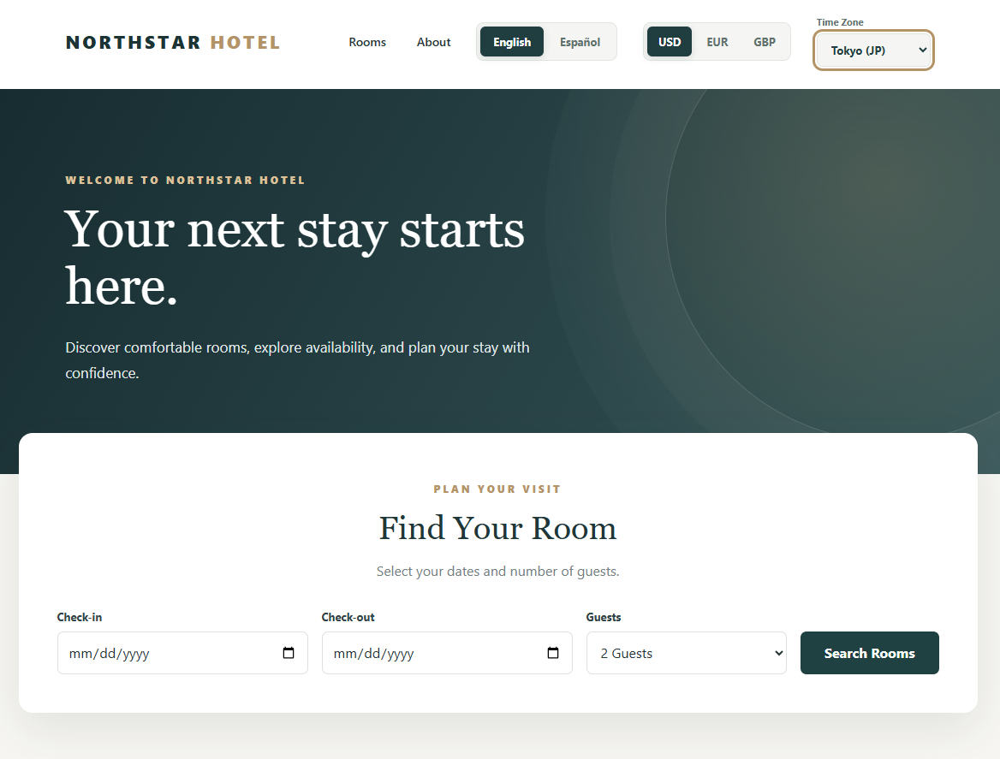
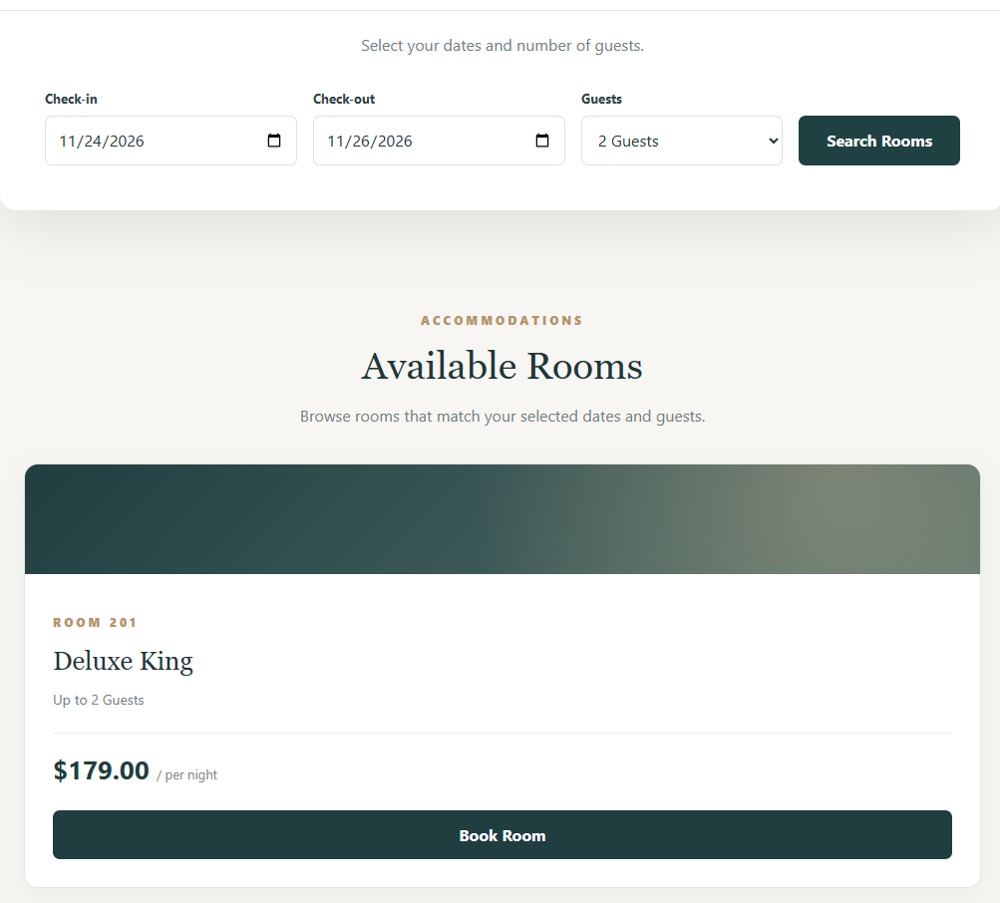
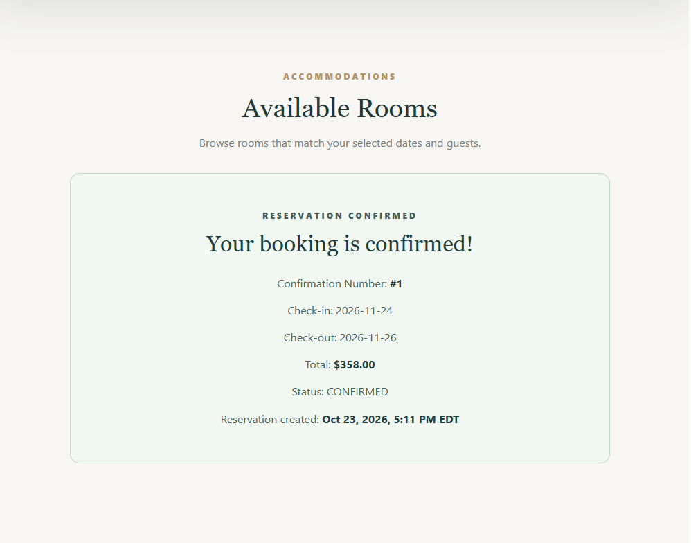
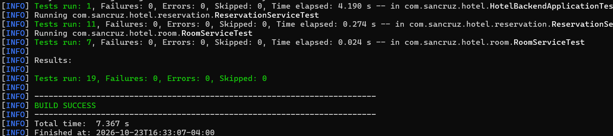

# Hotel Reservation System

A full-stack hotel reservation application built with Java, Spring Boot, Angular, MySQL, and Docker.

I built this project to practice connecting a frontend, backend, and database in one application. Users can search for available hotel rooms, enter their guest information, and make reservations through the website.

The application uses a fictional hotel called Northstar Hotel.

## Screenshots

### Hotel Homepage



### Room Availability



### Reservation Confirmation



### Automated Tests



## Features

- Search for available rooms using check-in dates, check-out dates, and guest count.
- View room types, guest capacity, and nightly rates.
- Create hotel reservations directly through the website.
- Prevent overlapping reservations for the same room.
- Validate reservation dates and room capacity.
- Calculate reservation totals based on nightly rates and the number of nights.
- Create and retrieve rooms, guests, and reservations through REST API endpoints.
- Cancel reservations through the API while keeping reservation history.
- Switch the website between English and Spanish.
- Display prices in USD, EUR, and GBP using demonstration exchange rates.
- View reservation creation timestamps in different time zones.
- Run the frontend, backend, and database using Docker Compose.

## Technologies Used

### Backend

- Java 21
- Spring Boot 4.1.1
- Spring Web MVC
- Spring Data JPA
- Hibernate
- MySQL 8.4
- Maven

### Frontend

- Angular 22
- TypeScript
- HTML
- CSS

### Testing

- JUnit 5
- Mockito
- H2 Database

### Containerization

- Docker
- Docker Compose
- Nginx

## Project Structure

```text
hotel-reservation-system/
├── backend/
│   ├── src/
│   ├── Dockerfile
│   ├── .dockerignore
│   └── pom.xml
│
├── frontend/
│   ├── src/
│   ├── Dockerfile
│   ├── .dockerignore
│   ├── nginx.conf
│   └── package.json
│
├── screenshots/
│   ├── hotel-home.png
│   ├── available-rooms.png
│   ├── reservation-confirmation.png
│   └── automated-tests.png
│
├── .gitignore
├── docker-compose.yml
└── README.md
```

The backend contains the REST API and database logic. The frontend contains the Angular website. Docker Compose runs the frontend, backend, and MySQL database together.

## Running the Application

### Requirements

- Docker Desktop
- Git

### 1. Clone the Repository

```bash
git clone https://github.com/sancruz68/hotel-reservation-system.git
cd hotel-reservation-system
```

### 2. Set the Database Password

In Windows PowerShell, run:

```powershell
$env:HOTEL_DB_PASSWORD = [System.Net.NetworkCredential]::new("", (Read-Host "Enter database password" -AsSecureString)).Password
```

Enter a database password when prompted.

The password is passed through an environment variable rather than stored directly in the source code.

### 3. Build and Start the Containers

```powershell
docker compose up --build -d
```

Docker Compose starts three services:

- MySQL database
- Spring Boot backend
- Angular frontend served through Nginx

### 4. Open the Application

Hotel website:

http://localhost:8088

Room API:

http://localhost:8088/api/rooms

The Docker database starts empty on a fresh installation. Rooms can be created using the REST API before testing availability and reservations.

### 5. Stop the Application

```powershell
docker compose down
```

The MySQL database uses a persistent Docker volume, so saved information remains available after containers are restarted.

Avoid using `docker compose down -v` unless you intend to remove the database volume.

## REST API Endpoints

### Rooms

| Method | Endpoint | Description |
|---|---|---|
| GET | `/api/rooms` | Retrieve active rooms |
| GET | `/api/rooms/{id}` | Retrieve a room by ID |
| GET | `/api/rooms/available` | Search for available rooms |
| POST | `/api/rooms` | Create a new room |

### Guests

| Method | Endpoint | Description |
|---|---|---|
| GET | `/api/guests` | Retrieve all guests |
| GET | `/api/guests/{id}` | Retrieve a guest by ID |
| POST | `/api/guests` | Register a guest |

### Reservations

| Method | Endpoint | Description |
|---|---|---|
| GET | `/api/reservations` | Retrieve all reservations |
| GET | `/api/reservations/{id}` | Retrieve a reservation by ID |
| POST | `/api/reservations` | Create a reservation |
| POST | `/api/reservations/{id}/cancel` | Cancel a reservation |

## API Examples

### Create a Hotel Room

**POST** `/api/rooms`

```json
{
  "roomNumber": "201",
  "roomType": "Deluxe King",
  "capacity": 2,
  "nightlyRate": 179.00
}
```

The API validates the room information and rejects duplicate room numbers.

### Search for Available Rooms

**GET**

```text
/api/rooms/available?checkInDate=2026-11-24&checkOutDate=2026-11-26&guestCount=2
```

The API returns rooms that are active, have enough capacity, and are not already reserved for the selected dates.

### Create a Reservation

**POST** `/api/reservations`

```json
{
  "guestId": 1,
  "roomId": 1,
  "checkInDate": "2026-11-24",
  "checkOutDate": "2026-11-26",
  "guestCount": 2
}
```

For a room priced at $179.00 per night, a two-night stay costs $358.00.

The backend checks the reservation dates, room capacity, and existing bookings before saving the reservation.

If the room is already reserved for overlapping dates, the API returns HTTP 409 Conflict.

## Automated Testing

I used JUnit and Mockito to test the backend's room and reservation logic.

The tests cover:

- Creating rooms with valid information
- Rejecting duplicate room numbers
- Rejecting invalid room capacity and nightly rates
- Checking availability search validation
- Calculating reservation totals
- Rejecting overlapping reservations
- Rejecting reservations exceeding room capacity
- Validating check-in and check-out dates
- Rejecting reservations for inactive rooms
- Handling missing guest, room, and reservation records
- Cancelling confirmed reservations

H2 is used as an in-memory database for the Spring Boot application startup test. This allows the test suite to run without requiring a local MySQL server.

### Run the Tests

Navigate to the `backend` folder and run:

```powershell
.\mvnw.cmd test
```

### Latest Test Results

**19 tests passed**

- Failures: 0
- Errors: 0
- Build: SUCCESS

The tests cover application startup and service logic. Database query behavior and concurrent reservation requests are not covered by separate automated integration tests.

## Docker Setup

The application uses Docker Compose to run three connected services.

**Angular / Nginx**

- Serves the hotel website on port 8088.
- Forwards API requests to the Spring Boot backend.

**Spring Boot**

- Processes room, guest, and reservation requests.
- Connects to the MySQL database inside the Docker network.

**MySQL**

- Stores rooms, guests, and reservations.
- Uses a Docker volume to preserve data.

I tested the Docker setup by creating a room, completing a reservation through the website, rejecting an overlapping booking, and restarting the containers to verify database persistence.

## Notes and Limitations

This is a portfolio project, not a production hotel booking service.

- All reservation prices are stored in USD.
- EUR and GBP prices use fixed demonstration exchange rates, not live rates.
- Time-zone selection changes how reservation creation timestamps are displayed, not the hotel's check-in and check-out dates.
- Existing guest email addresses cannot currently be reused through the website's booking form.
- Reservation cancellation is supported through the REST API but is not yet available through the website.
- Authentication, online payments, and production deployment are not implemented.

This project helped me practice REST API development, relational databases, frontend and backend integration, automated testing, and Docker-based application setup.
